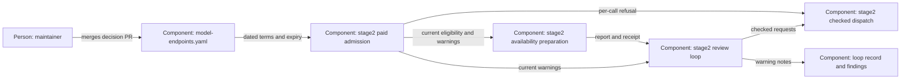

# Design — terms-expiry

This design applies `spec.md` using the recorded interview and repository
inspection at `97980181` on 2026-10-26.

## Alternatives

- **One shared terms assessment:** extend the existing `terms_problem`
  admission boundary and expose a separate warning helper using the same
  date parser and UTC clock. All current callers inherit expiry refusal;
  preparation and review add warning presentation and evidence. This keeps
  renewal semantics consistent but requires fixture updates across callers.
- **Separate expiry checks in each caller:** preparation, review, probes
  and interactive sessions each validate dates and generate warnings.
  Each interface can evolve independently, but operators risk inconsistent
  cutoffs and maintainers owe duplicate tests at every new call path.

Chosen: one shared terms assessment, because the existing declaration guard
already calls `terms_problem` before paid dispatch. The architecture proposal
takes effect when the decision pull request is merged.

## Interfaces

- `model-endpoints.yaml` → `scripts/stage2.py`: each paid `modelle_terms`
  record supplies a quoted ISO `valid_until`; a missing or invalid value is a
  refusal, never a request to calculate a runtime default.
- `terms_problem` → ladder selection and `declaration_problem`: retain the
  `str | None` contract. A problem names model, missing/invalid/passed date
  and, for an expired record, the recorded expiry. Existing skip, retention,
  source and training checks remain binding.
- Paid dispatch retains a current expiry check after earlier batch
  validation. Distinguish admission class from tool permissions: paid
  availability probes use `free=True` to disable tools, but still require
  paid terms. Only discovered free-class membership grants that exception.
- Shared warning helper → `stage2_availability.prepare` and `review_loop`:
  return deterministic model/date messages for `0 <= expiry - UTC today <= 7`.
  Print them before calls so failures cannot hide advance notice; evaluate
  again on resumed and legacy loops. Completed clean-stop invocations that
  perform no terms evaluation need no new evidence.
- Preparation → receipt/report: add an optional `terms_warnings` list under
  `state["availability"]`, print it in the report and include it in the
  existing receipt digest. Absence on an older receipt means no historical
  warnings, never current admission. Retain the existing acknowledgment,
  freshness and configuration/diff binding rules.
- Review → loop record → released findings: include current warning lines
  as round notes using existing evidence transfer, including on free rounds
  of a run with paid candidates. Refused calls print diagnostics without
  inventing a round or consuming a stage.

## Data model

- `valid_until` is a required string field for admission, beside `gelesen`,
  `quelle`, `aufbewahrung` and `training`. Reuse strict calendar validation
  and one UTC date seam; tests control that seam without freezing unrelated
  runner accounting or document-stamp clocks.
- At migration, both DeepSeek records use source/re-read date 2026-10-25,
  monthly-agreement retention prose and expiry 2026-10-31. All other existing
  records, including wire-API skips, use their existing reading date plus
  30 days; no new reading is claimed for them.
- At renewal, the agent proposes the source's explicit end date, otherwise
  the new reading date plus 30 days. The maintainer merges the decision PR;
  the runner only reads these fields and never renews them.
- Existing saved membership, consumed stages, round numbering and receipt
  versions need no migration. Optional warning evidence is additive. Current
  per-call declaration checks override expired historical eligibility;
  they may refuse a saved round rather than rebuild its membership.

## ADR draft

The proposal is `docs/adr/0022-paid-model-terms-expire.md`, following
`templates/adr.md`. It amends ADR 0021 decision 5 and its availability
amendment's paid-admission prerequisite, supersedes no ADR and amends no
numbered D- or O-decision. No historical ADR edit or decision-continuity
mapping change is required. The spec claims this single new ADR; no
maintainer ADR answer is authored here.

## Architecture delta

**Added**

- A machine-readable end date and optional warning evidence in the existing
  configuration and records, without a new service or persistent store.

**Changed**

- Paid admission checks expiry using the current UTC day, including when
  consuming a saved selection; preparation and review expose advance notice.
- The maintainer's terms-reading procedure includes expiry renewal by
  decision pull request.

**Removed**

- Indefinite admission from a reading without a machine-readable end date;
  no existing component is removed.
