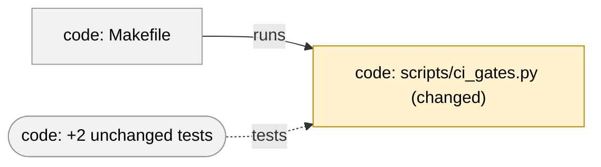

# Plan — touch-map

```text
For you:     every code pull request shows what it touches: a generated list, and a collapsed map when a link is found, in both templates
Done when:   criteria 1–18 hold (tests with planted faults, a run on eight merges, links checked by hand on two), `make verify` green
Appetite:    4 h of phase 4, one repair round included
Not now:     the CI gate that checks the pasted section is current, the question after five pull requests, LakeSwitch, ADR 0009
Pre-mortem:  suppose it failed: most likely because sections go stale after later pushes, and nothing checks them until the freshness gate
Starts unless you say stop.
```

Implements `spec.md` (criteria 1–18). The class is `feature`, ADR answer
"no" (the maintainer, 2026-10-06); `adr-answers` stays red until the
orchestrating session records it. Stage 1: no model markings. Facts read at
`a887b82`.

## Decided in phase 3

No `[DECISION]` is open.

- `[DETAIL]` — **appetite 4 h.** The steps below sum to 3 h 40 min; 20 min
  is one repair round. It is above research 4.9's 2–3 h, which is the note's
  estimate for the prototype's rules alone; the spec adds the join rule,
  outward links, the import delta, removed files and a hand check on two
  merges. Neither `decisions.md` nor `spec.md` states an appetite.
- `[DETAIL]` — **git plumbing only:** `diff-tree`, `ls-tree`, `cat-file`,
  `merge-base`, `rev-parse`, each with `-z` where it lists paths. Porcelain
  `git diff` follows the user's `diff.renames`, `color.ui` and
  `core.quotepath`, and a name with a `"` comes back quoted.
- `[DETAIL]` — **box ids `n1`, `n2`, … in box order**, never from the file
  name: `a-b.py` and `a_b.py` would collide, and `end` closes a block.
- `[DETAIL]` — **labels replace `"` and a backtick with `'`**; the list
  keeps the real path.
- `[DETAIL]` — **output is UTF-8 whatever the locale:** `main` writes the
  encoded text to `sys.stdout.buffer` (the list uses `·` and `→`).

## Slices and steps

Three slices; each ends green and committed. Read `date` at each step
boundary (`prompts/04-implement.md`).

### S1 — the list (110 min)

1. **`scripts/touch_map.py`** (new, 70 min). Docstring: usage, the rules of
   the spec's terms in short, exit codes 0/2/3. Constants at the top — the
   one place an instance changes them: `RUNNERS = ("Makefile",
   "decisions/gates.yaml")`, `RUNNER_DIRS = (".github/workflows/",)`,
   `TESTS = "tests/"`, `CODE = (".py", ".sh")`, `PROSE_DIRS = ("docs/",
   "plans/")`, `REGISTRY_PATHS = 15`, `BASENAME_LONGER_THAN = 8`,
   `SPLIT_FROM = 15`, `MAP_MAX = 30`. Parts:
   - `git(repo, *args) -> str`; `CannotMeasure`; `resolve(repo, base, head)`
     → head, merge base and their short hashes, or `CannotMeasure` (not a
     repository, a revision that does not resolve, no merge base).
   - `changed(repo, mb, head) -> dict[str, str]` from `git diff-tree -r -z
     --no-renames --name-status`: `A` new, `D` removed, else changed.
   - `Snapshot(repo, rev)`: tracked paths, source texts (read lazily with
     `cat-file`), unique long basenames, unique `.py` stems.
   - `kind(path)`, `is_prose(path)`, `read_code(path, body)` (the
     prototype's `code_only`, built as `read_code`, which returns the code
     text with its Python tree; for other sources it drops what follows a
     `#` that starts a comment (`_strip_comments`, since repair round 1, in
     round 2 across lines; in phase 4 whole-line comments only). A wrapper `code_text`, which nothing
     called, stood beside it in phase 4; repair round 1 removed it).
   - `names(snap, src)` — full path, unique basename, and for Python the
     `/` joins walked on the AST (trailing string constants of a chain of
     `ast.Div`, joined, matching exactly one tracked path or its end after a
     `/`); `imported(snap, src)` — first components of absolute imports
     through the unique stems.
   - `links(snap) -> set[tuple[str, str, str]]` — `(source, target, kind)`
     by the spec's terms, registries and self links skipped.
   - `build(repo, base, head) -> Touch` — boxes (criteria 3 and 5), drawn
     links, fold counts, `still named by`, prose, not linked, imports added
     and dropped; links of a removed file from the merge base's snapshot.
   - `render_list(touch) -> list[str]`, `main(argv=None) -> int` (argparse
     `base`, `head`, `--repo`, default `.`); `CannotMeasure` → the line on
     standard error, exit 3.
2. **Tests, ratchets, kit** (40 min). `tests/test_touch_map.py` (new):
   docstring — every test builds its own repository, so the file holds in
   the probe copy. Helpers as in `tests/test_frontmatter_current.py` (git
   with `-c user.name=t -c user.email=t@example.invalid -c
   commit.gpgsign=false`, `GIT_CONFIG_GLOBAL=/dev/null`,
   `GIT_CONFIG_NOSYSTEM=1`): `_repo`, `_commit(repo, {path: text | None})`,
   `_branch`, and `_run(repo) -> str` calling `touch_map.main(["main",
   "feat", "--repo", …])`. The S1 rows of the table below.
   `scripts/ci_gates.py`: `OHNE_AUFRUFER["touch_map.py"] = "Entry point,
   not a gate — an agent runs it before a pull request and pastes its
   output (prompts/07-commit.md); tests/test_touch_map.py runs it"`.
   `scripts/kit/manifest.yaml`: after the `check_research_currency.py`
   rule, `scripts/touch_map.py` → `mechanismus` ("the pull request
   templates name it, and they travel"); after the
   `test_research_currency.py` rule, `tests/test_touch_map.py` →
   `mechanismus` ("builds its own repositories; holds in the probe copy").
   Verify, commit.

### S2 — the map (70 min)

3. **Map, size lines, lists, caption** (40 min). `render(touch) -> str`
   assembles the whole output below; `render_map` numbers the boxes —
   changed boxes in list order, then unchanged boxes by path, then fold
   boxes in the order of their target — and sorts links by (source number,
   target number, kind). (25 min map and size lines, 15 min lists and
   caption.)
4. **Tests** (30 min): the S2 rows of the table, with the structure check
   `_mermaid_problems(block) -> list[str]` in the test file. Verify,
   commit.

### S3 — the convention and the measurement (40 min)

5. **Templates, template test, prompt** (20 min).
   - Both templates, between the sections the spec names (criterion 14):

     ```markdown
     ## What it touches
     <the output of `python3 scripts/touch_map.py origin/main HEAD`, pasted unchanged after the last push>
     <for a change with a design.md: "Architecture delta: `plans/changes/<name>/design.md`">
     ```

   - `tests/test_pr_templates.py`: `test_both_templates_carry_what_it_touches`
     — the heading once, between its neighbours, the command in the
     section, `(REPO / "scripts" / "touch_map.py").is_file()`; the docstring
     says it reads the script's presence too.
   - `prompts/07-commit.md`, after "The pull request text explains
     itself":

     ```markdown
     - **What it touches is generated, never drawn.** After the last push,
       run `python3 scripts/touch_map.py origin/main HEAD` and paste its
       output under "What it touches" unchanged, in either template. Never
       edit it, and never draw a map by hand or have a model draw one. When
       the branch moves, run it again and replace the whole section. A
       change with a `design.md` adds one line below it:
       `Architecture delta: plans/changes/<name>/design.md`.
     ```

     and "What it touches" after "What changes for you" in the sentence
     that follows the multi-decision form. Verify, commit.
6. **Measurement and close** (20 min). The runs under "Verification"; under
   `## Evidence` here, per merge: boxes, links, size line, map or not; for
   #73 and #65 each drawn link with the `file:line` that makes it, marked
   "dependency" or "fixture path". `implementation_status: partial` in the
   four artefacts of this folder (the freshness gate is still open),
   `python3 scripts/plans_registry.py --index`, verify, commit.

## The output, exactly

The tests assert these texts. A prose-only change prints only its line:

```text
Prose only: no code, runner or test changed.
```

Otherwise (an example; lines in brackets appear only when they apply):

````text
Touched at `a1b2c3d`, against the merge base `e4f5a6b`:

- `scripts/ci_gates.py` (changed) · run by `Makefile`, `scripts/verify_all.sh` · imported by `scripts/harness.py` · tested by `tests/test_ci.py`, +2 unchanged
- `scripts/old.py` (removed) · run by `Makefile` · still named by `Makefile`
- `tests/test_kit.py` (changed) · tests `kit/probe.py`, `Makefile`
- `prompts/07-commit.md` (changed) · tested by +1 unchanged
[- Not linked: `.gitignore`]
[- Prose, not drawn: 4 files]

[Large change: consider splitting it.]
[Map left out: 34 boxes, more than 30.]

<details><summary>Map at a1b2c3d</summary>



- **Added:** none. New imports: `scripts/a.py` → `scripts/b.py`.
- **Changed:** `prompts/07-commit.md`, `scripts/ci_gates.py`, `tests/test_kit.py`.
- **Removed:** `scripts/old.py`. Imports dropped: none.

<sub>Generated by scripts/touch_map.py from the commit a1b2c3d and the merge base e4f5a6b; nothing drawn by hand. Links are found by reading the code, so some may be missing. A box is a file at C4 level code; new, changed and removed show in words and in colour.</sub>
</details>
````

- Lines of changed boxes: code, tests, runners, other; each group by path.
  Groups within a line in this order: `run by`, `read by`, `imported by`,
  `tested by`, `runs`, `reads`, `imports`, `tests`, `still named by`; names
  sorted. A neighbour is named by its label (folder and file); the line's
  own file by its full path.
- A label is `code: ` plus folder and file (`Makefile` alone at the root),
  plus ` (new)`, ` (changed)` or ` (removed)` for a changed box.
- The three lists and the imports in them by path; `1 file` /
  `<n> files`; `none` where a list or delta is empty.

## Tests

| Crit. | Test (in `tests/test_touch_map.py` unless named) | Goes red when (the planted fault) |
| --- | --- | --- |
| 1 | `test_the_working_tree_does_not_count`, `test_two_runs_give_the_same_bytes`, `test_only_the_standard_library` | sources read from disk; a set iterated unsorted; `import yaml` |
| 2 | `test_the_merge_base_is_the_start`, `test_a_rename_is_removed_and_new` | the diff taken from base, not the merge base; rename detection on |
| 3 | `test_which_changed_files_are_boxes` | a code file without links dropped; a script's path naming kept as a link |
| 4 | `test_each_kind_of_link` (import, runner, shell, test path, basename, join, `reads`); `test_what_makes_no_link` (comment, docstring, `#` line, script naming, 8-character basename, basename twice, join ending two paths, registry of 15) | `read_code` returns the raw body (the one function the links are read through; `_strip_comments` holds the `#` rule of the other sources); `> 8` becomes `>= 8`; a join takes the first of two paths; the registry threshold off by one |
| 5 | `test_a_tests_only_change_shows_the_code_it_tests`, `test_unchanged_tests_fold`, `test_a_fixture_path_is_not_a_box`, `test_one_hop_only`, `test_no_link_between_two_unchanged_boxes` | links only into changed code (the prototype's rule); one fold per test; an unchanged Markdown target drawn; a second hop; an unchanged pair linked |
| 6 | `test_a_removed_script_still_named` | a removed file's links read at head; no `still named by` |
| 7 | `test_prose_only_is_one_line` | an empty `flowchart LR` printed |
| 8 | `test_the_list_and_the_map_hold_the_same_links`, `test_no_table_or_checkbox` | a link left out of the list; a line starting with `\|` |
| 9 | `test_the_size_lines` at (1 box, no link), 14, 15, 30, 31 boxes — one changed module and unchanged importers — and 14 files plus one fold box | `>= 15` becomes `> 15`; `<= 30` becomes `< 30`; fold boxes not counted |
| 10 | `test_boxes_carry_level_and_status_in_words` | the status word dropped from a label |
| 11 | `test_the_block_holds_by_structure` (`a"b.py`, a backtick name, `end.sh`, `a-b.py` and `a_b.py`); `test_the_structure_check_can_go_red` | labels not cleaned; ids made from names; the check passes an undeclared end |
| 12 | `test_imports_added_and_dropped`, `test_the_caption_names_both_commits` | the delta from head alone; the merge base's hash missing |
| 13 | `test_not_measured` (no repository, unknown revision, unrelated histories), `test_a_usage_error_is_2` | an exception escapes (exit 1); the message on standard output |
| 14 | `tests/test_pr_templates.py::test_both_templates_carry_what_it_touches` | the section below `## Where it fits`; the script renamed |
| 16 | `test_the_kit_carries_the_script_and_its_test` (`probe.rolle`); the ratchets of `tests/test_ci.py`; gate `leerprobe` | a role `bestand`; the `OHNE_AUFRUFER` entry missing |
| 15, 17 | read in phase 6; the runs below, recorded under `## Evidence` | — |
| 18 | `make verify` | — |

Each fault is planted on its own, the suite run, the file restored with
`git checkout`, and the result recorded under `## Planted faults`.

## Verification

```bash
GIT_CONFIG_COUNT=1 GIT_CONFIG_KEY_0=commit.gpgsign GIT_CONFIG_VALUE_0=false make verify
for m in 6c5d51a 3715528 d5813ec a847516 00d7c31 ba940fb 017ec56 87daf91; do echo "== $m"; python3 scripts/touch_map.py "$m^1" "$m^2"; done
```

## Not touched

`decisions/gates.yaml` and `.github/workflows/ci.yml` (no gate: the
freshness gate is a later change), `tests/test_ci.py` (its lists stay;
`OHNE_TEST` and `OHNE_MUTATIONSTEST` do not grow), `scripts/kit/probe.py`
and `REIST_NICHT`, `scripts/export/manifest.yaml` (its catch-all drops the
script, as for the sibling checks), `provenance.yaml`,
`docs/adr/0009-architecture-delta-in-design-md.md`, `docs/WORKFLOW.md`,
`AGENTS.md`, the templates' `Where it fits` line and `DECISION_PARTS` in
`tests/test_pr_templates.py`, and anything in LakeSwitch.

## Planted faults

Every test has its counterpart: a fault planted on its own, the suite run, the
file restored with `git checkout`. Before every fault of slice S1: `python3 -m
pytest tests/test_touch_map.py -q` — **19 passed** at `a21717a`. After: **24
faults, 24 red, none green.** Planted on `a21717a`.

Replay: make the edit in the file of the column `File` — `script` is
`scripts/touch_map.py`, `manifest` is `scripts/kit/manifest.yaml`,
`ci_gates.py` is `scripts/ci_gates.py` — run `python3 -m pytest
tests/test_touch_map.py -q --tb=no` (`tests/test_ci.py` for fault 24), and
restore with `git checkout -- <file>`. "Red" is the number of failing tests;
the tests named are up to three of them, in alphabetical order.

| # | Crit. | File | Fault | Red | Tests that went red |
| --- | --- | --- | --- | --- | --- |
| 1 | 1 | script | sources read from disk, not from the commit | 4 | `test_a_removed_script_still_named`, `test_a_rename_is_removed_and_new`, `test_the_merge_base_is_the_start` |
| 2 | 1 | script | a set iterated unsorted (boxes in set order) | 2 | `test_two_runs_give_the_same_bytes`, `test_which_changed_files_are_boxes` |
| 3 | 1 | script | import yaml | 1 | `test_only_the_standard_library` |
| 4 | 2 | script | diff taken from the base tip, not the merge base | 2 | `test_not_measured`, `test_the_merge_base_is_the_start` |
| 5 | 2 | script | rename detection on | 1 | `test_a_rename_is_removed_and_new` |
| 6 | 3 | script | a code file without links dropped | 5 | `test_a_rename_is_removed_and_new`, `test_the_merge_base_is_the_start`, `test_the_working_tree_does_not_count` |
| 7 | 3 | script | a Python code file's path naming kept as a link | 4 | `test_each_kind_of_link`, `test_no_link_between_two_unchanged_boxes`, `test_one_hop_only` |
| 8 | 4 | script | code text is the raw body (comments and docstrings stay) | 1 | `test_what_makes_no_link` |
| 9 | 4 | script | basename rule `> 8` becomes `>= 8` | 1 | `test_what_makes_no_link` |
| 10 | 4 | script | a join takes the first of two paths | 1 | `test_what_makes_no_link` |
| 11 | 4 | script | registry threshold off by one | 1 | `test_what_makes_no_link` |
| 12 | 5 | script | links only into changed code (the prototype's rule) | 2 | `test_a_fixture_path_is_not_a_box`, `test_a_tests_only_change_shows_the_code_it_tests` |
| 13 | 5 | script | an unchanged test drawn as its own box | 3 | `test_the_working_tree_does_not_count`, `test_unchanged_tests_fold`, `test_what_makes_no_link` |
| 14 | 5 | script | an unchanged Markdown target of a changed test drawn | 1 | `test_a_fixture_path_is_not_a_box` |
| 15 | 5 | script | a second hop | 2 | `test_a_tests_only_change_shows_the_code_it_tests`, `test_one_hop_only` |
| 16 | 5 | script | a link between two unchanged boxes drawn | 1 | `test_no_link_between_two_unchanged_boxes` |
| 17 | 6 | script | a removed file's links read at head, not the merge base | 1 | `test_a_removed_script_still_named` |
| 18 | 6 | script | no `still named by` | 1 | `test_a_removed_script_still_named` |
| 19 | 7 | script | no prose-only line: the full list is printed with an empty header | 1 | `test_prose_only_is_one_line` |
| 20 | 13 | script | an exception escapes (exit 1) | 1 | `test_not_measured` |
| 21 | 13 | script | the not-measured line on standard output | 1 | `test_not_measured` |
| 22 | 13 | script | usage error exits 1 | 1 | `test_a_usage_error_is_2` |
| 23 | 16 | manifest | kit role of the script is `bestand` | 1 | `test_the_kit_carries_the_script_and_its_test` |
| 24 | 16 | ci_gates.py | the OHNE_AUFRUFER entry missing | 1 | `test_every_script_has_a_caller_or_a_declared_reason` |


Slice S2 (the map), planted on `badb919`. Before every fault: `python3 -m pytest
tests/test_touch_map.py -q` — **27 passed**. After: **21 faults, 21 red, none
green** — after one repair: fault 41 (the structure check passes a duplicate
id) stayed **green** on the first run, because its bad block also broke the
link-end rule and so still raised a problem. The test was sharpened (each bad
block breaks one rule and the test asserts the problem that names it, commit
`test(touch-map): each bad block …`), the fault was planted again and went red.
`test file` in the column `File` is `tests/test_touch_map.py` itself: the fault
is planted in the structure check, and the test that must go red is the one that
feeds it bad blocks.

| # | Crit. | File | Fault | Red | Tests that went red |
| --- | --- | --- | --- | --- | --- |
| 25 | 8 | script | a link left out of the list (the last drawn link) | 8 | `test_a_fixture_path_is_not_a_box`, `test_a_removed_script_still_named`, `test_a_tests_only_change_shows_the_code_it_tests` |
| 26 | 8 | script | a list line starting with `\|` (the prose line) | 3 | `test_no_table_or_checkbox`, `test_the_list_and_the_map_hold_the_same_links`, `test_which_changed_files_are_boxes` |
| 27 | 8 | script | the fold links left out of the map | 1 | `test_the_list_and_the_map_hold_the_same_links` |
| 28 | 9 | script | `>= 15` becomes `> 15` | 1 | `test_the_size_lines` |
| 29 | 9 | script | `<= 30` becomes `< 30` | 1 | `test_the_size_lines` |
| 30 | 9 | script | fold boxes not counted | 1 | `test_the_size_lines` |
| 31 | 9 | script | `> 30` becomes `>= 30` in the left-out line | 1 | `test_the_size_lines` |
| 32 | 9 | script | a map printed for boxes without a link | 1 | `test_the_size_lines` |
| 33 | 10 | script | the status word dropped from a label | 1 | `test_boxes_carry_level_and_status_in_words` |
| 34 | 10 | script | the level `code:` dropped from a label | 1 | `test_boxes_carry_level_and_status_in_words` |
| 35 | 10 | script | the map outside `<details>` | 3 | `test_boxes_carry_level_and_status_in_words`, `test_no_table_or_checkbox`, `test_the_size_lines` |
| 36 | 10 | script | a link without its kind | 2 | `test_the_block_holds_by_structure`, `test_the_list_and_the_map_hold_the_same_links` |
| 37 | 11 | script | labels not cleaned of `"` and backtick | 1 | `test_the_block_holds_by_structure` |
| 38 | 11 | script | ids made from the file names | 1 | `test_the_block_holds_by_structure` |
| 39 | 11 | script | control characters not flattened (a newline in a name) | 1 | `test_the_block_holds_by_structure` |
| 40 | 11 | test file | the structure check passes an undeclared link end | 1 | `test_the_structure_check_can_go_red` |
| 41 | 11 | test file | the structure check passes a duplicate id | 1 | `test_the_structure_check_can_go_red` |
| 42 | 12 | script | the import delta taken from head alone | 1 | `test_imports_added_and_dropped` |
| 43 | 12 | script | imports dropped not reported | 1 | `test_imports_added_and_dropped` |
| 44 | 12 | script | the merge base's hash missing from the caption | 1 | `test_the_caption_names_both_commits` |
| 45 | 1 | script | unchanged boxes in set order (numbers differ by hash seed) | 3 | `test_a_tests_only_change_shows_the_code_it_tests`, `test_no_link_between_two_unchanged_boxes`, `test_two_runs_give_the_same_bytes` |

Slice S3 (the templates), planted on `34b412d`. Before every fault:
`python3 -m pytest tests/test_pr_templates.py -q` — **7 passed**. After: **6
faults, 6 red, none green.** The prompt bullet (criterion 15) has no test: it is
read in phase 6.

| # | Crit. | File | Fault | Red | Tests that went red |
| --- | --- | --- | --- | --- | --- |
| 46 | 14 | ordinary template | the section below `## Where it fits` | 1 | `test_both_templates_carry_what_it_touches` |
| 47 | 14 | decision template | the section below `## Where it fits` | 1 | `test_both_templates_carry_what_it_touches` |
| 48 | 14 | ordinary template | the section stands twice | 1 | `test_both_templates_carry_what_it_touches` |
| 49 | 14 | decision template | a third line in the section | 1 | `test_both_templates_carry_what_it_touches` |
| 50 | 14 | ordinary template | another command named (`touch_map.py HEAD`) | 1 | `test_both_templates_carry_what_it_touches` |
| 51 | 14 | script | `git mv scripts/touch_map.py scripts/touch_map_renamed.py`, put back with `git mv` | 1 | `test_both_templates_carry_what_it_touches` |

Totals over the change: **51 faults planted, 51 red** (one of them only after the
test repair named above).

## Evidence

Run on 2026-10-06 at 18:39 on `34b412d` (the head of this branch; the later
commits change only this file and the `implementation_status` of the four
artefacts). `GIT_CONFIG_COUNT=1 GIT_CONFIG_KEY_0=commit.gpgsign
GIT_CONFIG_VALUE_0=false make verify` ended `VERIFY GREEN — every local gate of
the 'verify' job passed`: 628 passed, 15 skipped (27 of the passed in
`tests/test_touch_map.py`, 1 new in `tests/test_pr_templates.py`); `ruff-check`,
`ruff-format`, `leerprobe`, `plans-registry`, `frontmatter-current`,
`adr-answers`, `gate-schema`, `ci-drift` and `ramp-valves` green. `docs-links`
(51 findings, none in a file of this change) and `markdownlint` are report-only
gates and red, as they were before the first commit.

`OHNE_TEST`, `OHNE_MUTATIONSTEST` and `REIST_NICHT` are unchanged: `git diff
origin/main` shows no change in `tests/test_ci.py` or `scripts/kit/probe.py`, and
`scripts/ci_gates.py` gained one `OHNE_AUFRUFER` entry (criterion 16).

### The eight merges (criterion 17)

`python3 scripts/touch_map.py <merge>^1 <merge>^2`, each exit 0 and under one
second. "Links" counts the drawn links plus one fold link per folded box.

| Merge | Pull request | Boxes (changed / unchanged / fold) | Links | Size line | Map |
| --- | --- | --- | --- | --- | --- |
| `6c5d51a` | #68 handover | prose only | — | the one line | no |
| `3715528` | #72 research hermes | prose only | — | the one line | no |
| `d5813ec` | #73 research-currency | 13 (7 / 2 / 4) | 15 (11 + 4) | none | yes |
| `a847516` | #70 ADR 0009 (a decision PR) | 4 (1 / 2 / 1) | 3 (2 + 1) | none | yes |
| `00d7c31` | #66 translate scripts | 17 (5 / 7 / 5) | 14 (9 + 5) | Large change | yes |
| `ba940fb` | #54 harness decide adr | 36 (20 / 7 / 9) | 39 (30 + 9) | Large change, Map left out: 36 boxes | no |
| `017ec56` | #65 translate tests | 21 (5 / 15 / 1) | 18 (17 + 1) | Large change | yes |
| `87daf91` | #71 roadmap trial | 4 (2 / 0 / 2) | 2 (0 + 2) | none | yes |

Against the prototype's counts in `research.md` 1.4: #73 4 boxes and 3 links
there, 13 and 15 here; #65 and #71, which drew nothing or an empty block, draw 21
and 4 boxes; #54 17 boxes there, 36 here (over the line, so no map); #66 17 boxes
and 14 links in both. #68 and #72 print the prose-only line, as criterion 17
asks; #71 is not prose-only, as research 5.5 predicted. Each of the five tests
of #65 has at least one link to the code it tests (`test_feedback_channel.py`,
`test_gate_machinery.py`, `test_gate_record.py`, `test_kit.py`,
`test_regelwerk.py`). Checked by hand: every link below has a line in its
source's code, and none comes from a comment, a docstring or a registry. The
mark says what the line is: **dependency** — the test imports the file, runs it
or reads the repository's own copy; **fixture path** — the path is text, a file
written into a temporary tree, a rule prefix or a reason string, and no read of
the repository's file. A fixture path is a false link the rules cannot tell
apart (spec, non-goals); the section does not claim to be free of them.

**#73** (`d5813ec`, head `4dd821e`) — 11 drawn links and the 8 unchanged tests
behind its 4 fold links:

| Link | Line that makes it | Mark |
| --- | --- | --- |
| `ci.yml` runs `check_research_currency.py` | `.github/workflows/ci.yml:144` | dependency |
| `ci.yml` runs `ci_gates.py` | `.github/workflows/ci.yml:106` | dependency |
| `ci.yml` runs `kit/probe.py` | `.github/workflows/ci.yml:73` | dependency |
| `gates.yaml` runs `check_research_currency.py` | `decisions/gates.yaml:213` | dependency |
| `gates.yaml` runs `ci_gates.py` | `decisions/gates.yaml:152` | dependency |
| `gates.yaml` runs `kit/probe.py` | `decisions/gates.yaml:76` | dependency |
| `test_research_currency.py` tests `_INDEX.md` | `tests/test_research_currency.py:119` | fixture path |
| `test_research_currency.py` tests `check_research_currency.py` | `tests/test_research_currency.py:33` (import; also `:29`) | dependency |
| `test_research_currency.py` tests `ci_gates.py` | `tests/test_research_currency.py:34` | dependency |
| `test_research_currency.py` tests `kit/manifest.yaml` | `tests/test_research_currency.py:807` (the assertion message; the test reads the manifest through `probe.rolle`, line 806) | dependency |
| `test_research_currency.py` tests `kit/probe.py` | `tests/test_research_currency.py:35` | dependency |
| fold: `test_ci.py` tests `ci.yml` | `tests/test_ci.py:28` | dependency |
| fold: `test_gate_machinery.py` tests `ci.yml` | `tests/test_gate_machinery.py:222` (`tmp_path / "ci.yml"`) | fixture path |
| fold: `test_regelwerk.py` tests `ci.yml` | `tests/test_regelwerk.py:34` | dependency |
| fold: `test_check_adr_answers.py` tests `gates.yaml` | `tests/test_check_adr_answers.py:466` | dependency |
| fold: `test_gate_machinery.py` tests `gates.yaml` | `tests/test_gate_machinery.py:52` | dependency |
| fold: `test_frontmatter_current.py` tests `plans/INDEX.md` | `tests/test_frontmatter_current.py:521` | fixture path |
| fold: `test_workflow_entry.py` tests `plans/INDEX.md` | `tests/test_workflow_entry.py:77` (`root / "INDEX.md"`, a temporary root) | fixture path |
| fold: `test_kit.py` tests `kit/manifest.yaml` | `tests/test_kit.py:59` (the assertion message; the test reads the manifest through `probe`) | dependency |

**#65** (`017ec56`, head `88c37bd`) — 17 drawn links and the 1 unchanged test
behind its fold link:

| Link | Line that makes it | Mark |
| --- | --- | --- |
| `test_feedback_channel.py` tests `handover_schema.py` | `tests/test_feedback_channel.py:32` | dependency |
| `test_gate_machinery.py` tests `ci.yml` | `tests/test_gate_machinery.py:222` (`tmp_path / "ci.yml"`) | fixture path |
| `test_gate_machinery.py` tests `gates.yaml` | `tests/test_gate_machinery.py:52` | dependency |
| `test_gate_machinery.py` tests `check_bead_export.py` | `tests/test_gate_machinery.py:283` | dependency |
| `test_gate_machinery.py` tests `check_dangling_bead_ids.py` | `tests/test_gate_machinery.py:348` | dependency |
| `test_gate_machinery.py` tests `check_decision_continuity.py` | `tests/test_gate_machinery.py:376` | dependency |
| `test_gate_machinery.py` tests `check_docs.py` | `tests/test_gate_machinery.py:249` | dependency |
| `test_gate_machinery.py` tests `ci_gates.py` | `tests/test_gate_machinery.py:28` | dependency |
| `test_gate_machinery.py` tests `plans_registry.py` | `tests/test_gate_machinery.py:327` | dependency |
| `test_gate_machinery.py` tests `ramp_valves.py` | `tests/test_gate_machinery.py:334` | dependency |
| `test_gate_machinery.py` tests `render_beads_export.py` | `tests/test_gate_machinery.py:434` | dependency |
| `test_gate_record.py` tests `gate_record.py` | `tests/test_gate_record.py:24` | dependency |
| `test_kit.py` tests `Makefile` | `tests/test_kit.py:303` (`r["prefix"] != "Makefile"`, a rule prefix; also `:307`) | fixture path |
| `test_kit.py` tests `_verdict.py` | `tests/test_kit.py:32` | dependency |
| `test_kit.py` tests `kit/probe.py` | `tests/test_kit.py:29` | dependency |
| `test_regelwerk.py` tests `ci.yml` | `tests/test_regelwerk.py:34` | dependency |
| `test_regelwerk.py` tests `ramp_valves.py` | `tests/test_regelwerk.py:30` | dependency |
| fold: `test_ci.py` tests `test_gate_machinery.py` | `tests/test_ci.py:1088` (a reason string that names the file) | fixture path |

Of the 37 rows (the link of `test_gate_machinery.py` to `ci.yml` stands in
both tables), 7 are marked fixture path, one of them a reason string: the false
links the rules cannot tell from dependencies. Every row has its line. The phone check (criterion 11, `spec.md`) is still the
maintainer's: the Mermaid block has been checked by structure only.

## Deviations of phase 4

None changes a criterion; each is a `[DETAIL]` the plan left open, decided in
the code and recorded here so that the next reading of the plan holds it.

- **A runner or shell script that names another runner makes no link.** The
  spec's `reads` is "any other file", and "other" is its defined term (not
  code, test or runner). No such naming exists at `34b412d` (counted), so the
  eight runs do not depend on it. If the maintainer reads "other" more widely,
  the change is one branch in `links`.
- **The test rows are split by slice:** criteria 1–7, 13 and 16 in S1 (the
  list), criteria 8–12 in S2 (the map); the plan's table does not say which.
- **A control character in a file name becomes `?`** in the list and the map
  (the spec names only `"` and backtick): a newline in a name would otherwise
  cut a list line and a Mermaid line in two. In the list a backtick in a name is
  carried by a longer code-span fence; the real path stays.
- **Two tests beyond the table:** `test_standard_output_is_utf8_whatever_the_locale`
  (the plan's `[DETAIL]` on UTF-8 had no row) and, after fault 41 stayed green,
  the sharper `test_the_structure_check_can_go_red`.
- **`main` returns argparse's exit code** (2) for a usage error instead of
  letting `SystemExit` escape, so a caller of `main(argv)` always gets an int.
- **The registry count leaves out the source's own path** (self links are
  skipped everywhere), and `ls-tree` runs with `--full-tree` so `--repo` may
  point into a subdirectory of a repository.
- **A removed file's `still named by` reads every source at head**, registries
  included: a stale name in a registry is exactly what the line is for.

## Repair round 1

The maintainer's answers and rules of 2026-10-06 (Claude Code session): F-3,
the one `[AMBIGUITY]`, is decided ("Kein Pfeil": a runner or shell script that
names a runner makes no link; no code change, `decisions.md` addendum and
`spec.md`, "Amendments" 1); the standing rule "MAJOR rows are repaired; MINOR
rows on tests, security or false statements are repaired without asking"
covers the other five. Each row is fixed in a commit of its own on
`feat/touch-map`; `scripts/touch_map.py`, its test file, `spec.md` and this
folder are the only files touched. The ratchets, the kit manifest, the
templates and the prompt stay as "Not touched" says.

| Row | Commit | What changed |
| --- | --- | --- |
| F-3 | `29ff487` | No code. `decisions.md` addendum (the question and the answer as stated); `spec.md`, terms, "Link": "a runner names no runner", and a new section "Amendments" at the end, nothing renumbered. |
| F-1 | `01ab55d` | The caption says links may be missing **and** a shown one can be false (a name in text, not a dependency). When the map is left out (above 30 boxes) and the list still prints links, a line of its own below the size lines says the same (`LINKS_CAVEAT`); with no link printed there is no caveat. `spec.md`, Amendments 2. |
| F-2 | `a696b03` | `_strip_comment` cuts a line of a shell script, `Makefile` or YAML runner at a `#` that is first on the line or follows a blank, outside single or double quotes (rule below); `read_code` uses it for every source that is not Python. |
| F-6 | `7262704` | `code_text` removed (nothing called it). The test table above names `read_code` (and `_strip_comment`) as the comment rule, and step 1 says how it was built. |
| F-5 | `fd9dab2` | `still_named` counts an import of a removed file's stem only when no tracked `.py` file at head has that stem (`Snapshot.py_stems`, shared stems included); a path in text counts as before. `spec.md`, Amendments 3. |
| F-4 | `b7e532f` | `render` prints the one line only when no changed file is a box **and** none is neither prose nor a box; otherwise the header line and the `Not linked` (and prose) lines, no size line, no map. `spec.md`, Amendments 4, which says it is a false statement repaired under the maintainer's rule. |

**The comment rule of F-2.** In a source that is not Python, a `#` starts a
comment when it is the first character of its line or follows a space or tab,
and no single or double quote is open at that point; a backslash outside
single quotes escapes the next character. So `echo hi  # x`, `steps: [] # x`
and a recipe line `echo build # x` lose what follows the `#`, and `$#`,
`${#a}`, `a#b`, a URL fragment (`/#top`), `"a # b"` and `'a # b'` stay code.
Quotes were tracked per line in round 1. This paragraph said of its two
limits (a quote over several lines is not followed; an apostrophe in plain
text hides the `#` after it) that both lie on the side of a link kept and
never of a link lost. That was false for the first: an inner line of a
quote, a heredoc body line and a `#` after an escaped blank are code the
shell reads, and the rule cut names from all three (F-7, measured at
`4a16cae`). Round 2 repaired the rule and states its limits under "Repair
round 2" below. A `.py` file that does not parse is read by this rule too.

`[DETAIL]`s this round decided, each reversible and covered by a test:

- **The caveat is one clause, the same words in both places** (the caption
  and the line below the size lines): "Links are found by reading the code,
  so some may be missing and a shown one can be false (a name in text, not a
  dependency)." The existing assertion on "some may be missing" still holds.
- **A change with no box and a file that is neither prose nor a box** prints
  the header line, then `- Not linked: …` and, when prose changed, `- Prose,
  not drawn: n files`. Nothing else: no "no code changed" sentence.
- **Spec amendments 2 and 3 were added beyond the two the dispatch named**
  (F-4's and F-3's), so that the spec stays the yardstick for what the
  output says (criteria 9, 12) and for `still named by` (criterion 6). Each
  only adds; none changes a number.

### Planted faults of the round

Each fault planted on its own on the tree of the commit that fixes its row
(not yet committed at the time), the file `tests/test_touch_map.py` run, the
file restored. The suite had 28 tests at F-1, 30 at F-2 and F-6, 31 at F-5 and
32 at F-4 and the head. "As it was" marks the fault that is the code before
the repair: it is red only because of the new test. Replay as under "Planted
faults" above; `script` is `scripts/touch_map.py`.

| # | Row | Crit. | File | Fault | Red | Tests that went red |
| --- | --- | --- | --- | --- | --- | --- |
| 52 | F-1 | 12 | script | the caption drops the caveat clause (as it was) | 1 | `test_links_may_be_false_wherever_they_are_printed` |
| 53 | F-1 | 9 | script | no caveat line when the map is left out | 1 | `test_links_may_be_false_wherever_they_are_printed` |
| 54 | F-1 | 12 | script | the caveat line printed whether or not a link is printed | 1 | `test_links_may_be_false_wherever_they_are_printed` |
| 55 | F-2 | 4 | script | only whole-line comments dropped (as it was) | 1 | `test_a_trailing_comment_makes_no_link` |
| 56 | F-2 | 4 | script | any `#` starts a comment, a blank before it not needed | 2 | `test_a_trailing_comment_makes_no_link`, `test_where_a_comment_starts` |
| 57 | F-2 | 4 | script | quotes ignored | 2 | `test_a_trailing_comment_makes_no_link`, `test_where_a_comment_starts` |
| 58 | F-2 | 4 | script | the backslash escape ignored | 1 | `test_where_a_comment_starts` |
| 59 | F-2 | 4 | script | only double quotes tracked | 2 | `test_a_trailing_comment_makes_no_link`, `test_where_a_comment_starts` |
| 60 | F-6 | 4 | script | `read_code` returns the raw body of a Python source (comments and docstrings stay) | 1 | `test_what_makes_no_link` |
| 61 | F-6 | 4 | script | `read_code` returns the raw body of any other source | 2 | `test_a_trailing_comment_makes_no_link`, `test_what_makes_no_link` |
| 62 | F-5 | 6 | script | the stem is not checked against head (as it was) | 1 | `test_a_moved_module_is_not_still_named` |
| 63 | F-5 | 6 | script | only unique stems count as resolving | 1 | `test_a_moved_module_is_not_still_named` |
| 64 | F-5 | 6 | script | an import never counts as naming the removed file | 1 | `test_a_removed_script_still_named` |
| 65 | F-4 | 7 | script | the one line whenever no box exists (as it was) | 1 | `test_prose_only_is_said_only_of_prose` |
| 66 | F-4 | 8 | script | the `Not linked` line only when a box exists | 1 | `test_prose_only_is_said_only_of_prose` |
| 67 | F-4 | 7 | script | the one line only when nothing at all changed | 1 | `test_prose_only_is_one_line` |

**16 faults planted in this round, 16 red, none green.** Over the change: 67
planted, 67 red. The eight merges of criterion 17, run again on `b7e532f` against
the script of `043023a`, differ in the caveat clause alone (the caption on five, a
line below the size lines on #54); boxes and links are the counts of the
table under "Evidence", and #68 and #72 still print the one line. On
`2ab9faf..ca597ab` (the ADR answer alone) the output is now the header and
`- Not linked: decisions/answers/touch-map/adr.yaml`.

## Repair round 2

The second repair round, for the three MINOR rows the review of round 1
raised (F-7, F-8, F-9, all `fix-r1`), under the maintainer's standing rule of
2026-10-06 (MINOR rows on tests, security or false statements are repaired
without asking). One commit per row on `feat/touch-map`; `scripts/touch_map.py`,
its test file, this plan and `findings.md` are the only files touched.

| Row | Commit | What changed |
| --- | --- | --- |
| F-8 | `29ecf4c` | `test_links_may_be_false_wherever_they_are_printed` gains the case of 31 unlinked files: the map is left out, no link is printed, no caveat line follows (Amendment 2). Test only. |
| F-9 | `e5261af` | `test_a_runner_names_no_runner`: a `Makefile` and a shell script name two runners and make no link, beside a control that reads a data file (the maintainer's decision for F-3). Test only. |
| F-7 | `36d1e4a` | `_strip_comment` (one line) becomes `_strip_comments` (the whole text), with `_scan` for one line. A quote is followed across lines; a heredoc body is code up to its end line; a blank that a backslash escapes is no blank before a `#`. Two tests: `test_a_name_the_shell_reads_is_not_cut` (the reviewer's three cases and the controls) and `test_where_a_comment_starts_across_lines`. The sentence above ("never of a link lost") is corrected. |

**The comment rule as it stands after round 2.** In a source that is not
Python, a `#` starts a comment when it is the first character of a line or
follows a blank that no backslash escapes, and no single or double quote is
open at that point. A quote stays open across lines until its mate. A
heredoc (`<<WORD`, `<<-WORD`, `<<'WORD'`, `<<"WORD"`, `<<\WORD`, several on
one line) turns the lines after it into code, whatever they hold, up to the
first line that is the delimiter once its blanks are taken off (YAML takes
the indent of a block scalar off before the shell reads it). `<<<` and
`<< 3` open none. The rule does not parse the shell, and it states which way
each of its limits errs:

- **A link kept that may be false** (the side the rule takes when in doubt):
  an apostrophe in plain text (`don't`) opens a quote, and every `#` after
  it is code until the next apostrophe (at the heads of the three
  repositories, 7 of 154 `.sh`, `.yml`, `.yaml` and `Makefile` files end
  with a quote still open); `$(( a << end ))` opens a heredoc that never
  ends; an end line that is not the delimiter alone keeps the rest.
- **A link lost** (a name the shell reads, cut): a construct the rule does
  not know. Known cases: a heredoc whose delimiter is built by expansion
  (`<<$end`), an ANSI-C string with an escaped quote (`$'a\'b'`), and the
  text of a YAML block scalar of prose, where a ` #` is text for YAML and a
  comment for this rule. None of these three is in the measured trees.

[DETAIL] decided this round, reversible and covered by a test: **an end line
may be indented** (`line.strip()`, not `line`), because the one heredoc
in a YAML file of the three checkouts (`templates/pre-flight-pipeline.yaml` of
portfolio-agentic-engineering) ends on an indented `EOF`, and a strict match
would keep the rest of every such file as code; the cost is a heredoc that
ends early when its body holds an indented line equal to the delimiter.
**`_strip_comment` is renamed `_strip_comments`**, since it takes the whole
text, and no one-line wrapper stays beside it (a wrapper called by a test
alone is what F-6 removed).

### Planted faults of the round

Replay as under "Planted faults" above, each fault alone on the tree of `36d1e4a`
(the script of `scripts/touch_map.py` there), the file `tests/test_touch_map.py`
run, the file restored. The suite has 35 tests at `36d1e4a` (32 at `0e0c78a`;
F-8 adds a case to an existing test, F-9 one test, F-7 two). Fault 68 is
fault 54's guard: fault 54 as recorded (the caveat in every output) was red
and stays so, and the guard it did not reach (`if has_links:` in the
left-out branch) is held now.

| # | Row | Crit. | File | Fault | Red | Tests that went red |
| --- | --- | --- | --- | --- | --- | --- |
| 68 | F-8 | 9 | script | the caveat line printed whenever the map is left out (`if has_links:` becomes `if True:`) | 1 | `test_links_may_be_false_wherever_they_are_printed` |
| 69 | F-9 | 4 | script | a runner or shell script that names a runner makes a `reads` link (`target in ("other", "runner")`) | 1 | `test_a_runner_names_no_runner` |
| 70 | F-9 | 4 | script | the same naming makes a `runs` link (`target in ("code", "test", "runner")`) | 1 | `test_a_runner_names_no_runner` |
| 71 | F-7 | 4 | script | the open quote is not carried to the next line | 2 | `test_a_name_the_shell_reads_is_not_cut`, `test_where_a_comment_starts_across_lines` |
| 72 | F-7 | 4 | script | no heredoc is ever opened | 2 | `test_a_name_the_shell_reads_is_not_cut`, `test_where_a_comment_starts_across_lines` |
| 73 | F-7 | 4 | script | a heredoc never ends | 2 | `test_a_name_the_shell_reads_is_not_cut`, `test_where_a_comment_starts_across_lines` |
| 74 | F-7 | 4 | script | the end line must be the delimiter without blanks (`line.strip()` becomes `line`) | 1 | `test_a_name_the_shell_reads_is_not_cut` |
| 75 | F-7 | 4 | script | a blank that a backslash escapes still counts as a blank | 2 | `test_a_name_the_shell_reads_is_not_cut`, `test_where_a_comment_starts_across_lines` |
| 76 | F-7 | 4 | script | a `<<` that is no marker advances one character, so `<<< "x"` opens a heredoc on `"x"` | 1 | `test_a_name_the_shell_reads_is_not_cut` |
| 77 | F-7 | 4 | script | only the first of two heredocs on a line is read | 1 | `test_where_a_comment_starts_across_lines` |

**10 faults planted in this round, 10 red, none green.** Over the change: 77
planted, 77 red. As it was: on the fixture of F-7 the script of `4a16cae` draws no
link at all, so the five names the shell reads (the reviewer's three, a `<<-`
body, a block scalar's heredoc body) are lost, and the script of `043023a`
draws 11, the six names in real comments among them (measured);
`test_a_name_the_shell_reads_is_not_cut` goes red on `4a16cae` (the second new
test calls `_strip_comments`, which that script does not have, so it says
nothing there). A run of the suite on `36d1e4a`: 35 passed;
`GIT_CONFIG_COUNT=1 GIT_CONFIG_KEY_0=commit.gpgsign GIT_CONFIG_VALUE_0=false make
verify` before each of the three commits: VERIFY GREEN (636 passed, 15 skipped at
`36d1e4a`; `docs-links` and `markdownlint` report-only and red, as before).

### The eight merges again (criterion 17)

The eight merges of the table under "Evidence", `python3 scripts/touch_map.py
<merge>^1 <merge>^2` with the script of `4a16cae` and of `36d1e4a`: **all eight
outputs are byte for byte the same.** Nothing changed beyond F-7's cases, and
F-7's cases do not occur in them. The same comparison over the last 40 merges
of each of coding-harness, portfolio-agentic-engineering and lakeswitch-ai
(120 outputs, each at its repository's head on 2026-10-06): none differs. On
the `.sh`, `.yml`, `.yaml` and `Makefile` files of the three heads
(`e5261af`, `20a279c`, `09c9d62`) the new rule keeps 79 lines as code that the
rule of round 1 cut (6, 41 and 32), every one a whole line starting with `#`
inside a quote, a heredoc or a stretch after a stray apostrophe; it cuts no
line that round 1 kept, and the lines it cuts in mid-line are the same in
number (17, 312, 1). None of the 79 lines makes a link in the 120 merges.

## Time used

Appetite: 4 h of phase 4, one repair round included. Read from `date`.

- 2026-10-06 18:10–18:44, 33 min, no break (appetite 4 h not reached; no
  repair round used beyond the one test sharpening of fault 41, inside S2)

Readings of `date` at the step boundaries: 18:10 start and baseline `make
verify` green · 18:23 S1 committed (`a21717a`) · 18:27 S1 faults recorded
(`4c47794`) · 18:31 S2 committed (`badb919`) · 18:37 S2 faults recorded
(`254e1fb`) · 18:39 S3 step 5 committed (`34b412d`) · 18:44 step 6 (evidence,
`implementation_status: partial`, plans index) committed (`04367eb`).

Repair round 1 (appetite 60 min, set by the dispatching session; not reached):

- 2026-10-06 21:39–21:56, 17 min, no break

Readings of `date` at the step boundaries: 21:39 start, state read (head
`043023a`) · 21:42 F-3 committed (`29ff487`) · 21:44 F-1 (`01ab55d`) · 21:47
F-2 (`a696b03`) · 21:49 F-6 (`7262704`) · 21:51 F-5 (`fd9dab2`) · 21:53 F-4
(`b7e532f`) · 21:56 this record, statuses and the plans index committed.

Repair round 2 (appetite 45 min, set by the dispatching session; not reached):

- 2026-10-06 22:13–22:32, 19 min, no break

Readings of `date` at the step boundaries: 22:13 start, state read (head
`0e0c78a`) · 22:17 F-8 committed (`29ecf4c`) · 22:18 F-9 (`e5261af`) · 22:29
F-7 (`36d1e4a`) · 22:32 this record, the plan's corrections and the statuses of
F-7 to F-9 committed.
