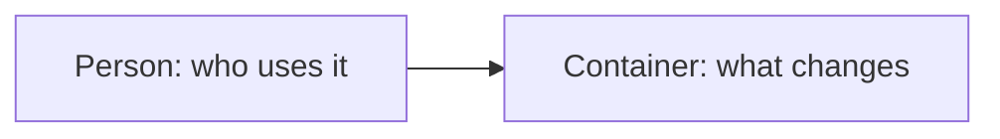

<!--
Template for a change's design (phase 2b). Copy it to
`plans/changes/<change>/design.md` and fill it in. This comment is not copied.
When a design is written, and for which class of change: `prompts/02b-design.md`.

1. The yaml block below is the header of the copy: put its lines between two
   `---` lines at the top and replace every `<...>`. It carries no header of
   its own here (`provenance.yaml`, prefix `templates/`). In the body a
   placeholder stands in backticks, so that GitHub shows it: replace it,
   backticks included.
2. Five parts, in this order (decision D-14). A part with nothing to say keeps
   its heading and says why in one sentence.
-->

```yaml
title: "Design — <change>"
category: design
created: <YYYY-MM-DD>
updated: <YYYY-MM-DD>
status: draft
implementation_status: none
date: <YYYY-MM-DD>
last_reviewed: <YYYY-MM-DD>
supersedes: null
superseded_by: null
bead: <bead id>
owner: <role>
provenance: ai-drafted-reviewed
produced_by: {kind: llm-session, name: <agent>, version: "<YYYY-MM-DD>"}
review: {status: pending, approved_by: null, approved_at: null}
tags: [design, <topic>]
```

# Design — `<change>`

How the system is shaped for the change that `spec.md` describes, written from
`spec.md`, `research.md` and `decisions.md`. What the spec fixes is not decided
again here; what it leaves open is decided here, or goes back to
`decisions.md` as a `[DECISION]`.

## Alternatives

At least two ways to meet the spec, each with its consequences for users,
operations or risk: what it makes easier, what harder, what is owed and by
whom.

* `<Alternative a — what it is.>` Consequences: `<for users, operations or risk.>`
* `<Alternative b — what it is.>` Consequences: `<for users, operations or risk.>`

Chosen: `<the alternative>`, because `<the reason>`. The choice is a proposal;
the merge of the pull request decides it.

## Interfaces

What crosses a boundary of the system in this change: each interface with its
two sides, what is passed and what is promised. If nothing does, write the
single line:

None — `<one sentence why>`

## Data model

What is stored: each record or file the change adds or changes, its fields and
who writes it. If nothing is, write the single line:

None — `<one sentence why>`

## ADR draft

The form is `templates/adr.md`. An `architectural` change always has one; a
`feature` has one when the answer to the ADR question for it is "yes".
Otherwise write the single line:

None — `<one sentence why>`

## Architecture delta

The part of the system this change touches, as it is after the change, as a
Mermaid flowchart, each box labelled with its C4 level (person, system,
container, component):



Below the diagram, the elements and relationships the change adds, changes and
removes, in three lists:

**Added**

- `<An element or relationship the change adds.>`

**Changed**

- `<An element or relationship the change changes, and how.>`

**Removed**

- `<An element or relationship the change removes.>`

If nothing architectural moves: one sentence why, in place of the diagram and
the lists.

The form is ADR 0009's.
